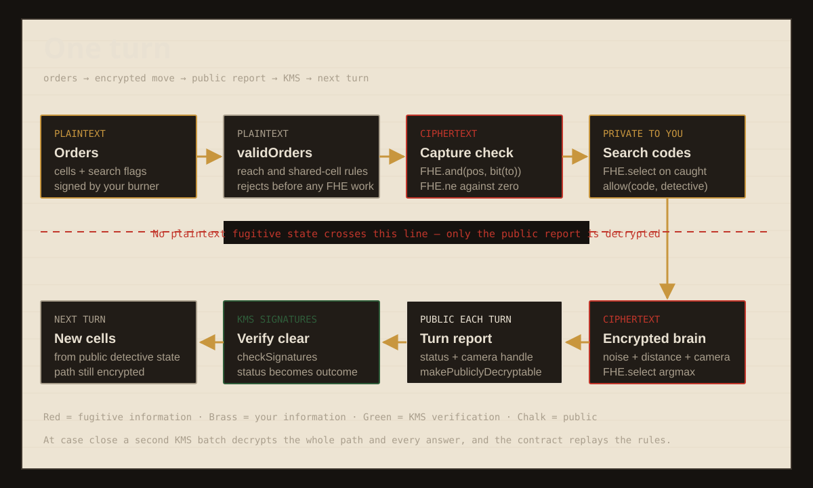
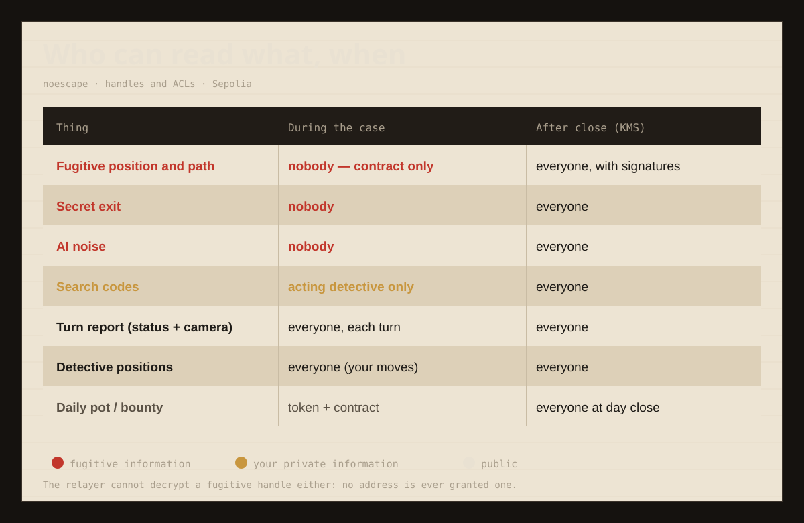

# noescape

> noescape is a manhunt where the fugitive lives inside the encryption: nobody on Earth knows where it is, not even us, yet it runs from you and every clue it gives is provably true.

This project is not audited, endorsed or operated by Zama. Use at your own risk.

**Live demo:** https://noescape-case.vercel.app

**Video pitch:** pending founder recording (H9). No video or voice has been generated by the agent.

## Try it in 60 seconds

1. Click **Take the case**. A burner key is created in your browser (no wallet, no install); GasTap funds it once per day after an invisible bot check.
2. Play two turns: move a detective with drag or arrow keys, toggle Search/Sprint, then **Send orders**. The worded stamps and radio log are real decryptions of encrypted search answers.
3. Open https://noescape-case.vercel.app/secret and click **Ask the relayer for the fugitive's position**. The relayer refuses: no address can read the position during a case.

Then watch a solved case: https://noescape-case.vercel.app/case/2/file

## Proof

- Contracts (Sepolia): [NoEscapeCase](https://sepolia.etherscan.io/address/0x0Ef4b145f8123356478aBB67C1429eDd4D9F65DA), [MostWanted](https://sepolia.etherscan.io/address/0x31606A8123D2e47450A06D94694A51AD7A20EfBD), [GasTap](https://sepolia.etherscan.io/address/0xBEE30A5CD444992887cCFb98D7B1d2832bA15aeb).
- Featured case `CaseVerified(2, true, 0, 0)`: [tx](https://sepolia.etherscan.io/tx/0xb53fc28822e2d9ae98f05aa80248a4415b9af681ec8a13b07df80b2ab060568a).
- Independent replay: `pnpm verify-case 2` prints every check ✓.
- Full transaction ledger and gas/wall times: [docs/proof.md](docs/proof.md). Security review: [docs/security.md](docs/security.md). Community validation: [docs/validation.md](docs/validation.md).

---

## Product

`noescape` is a turn-based hidden-movement game on Ethereum Sepolia. A fugitive is drawn from encrypted randomness and moves each turn by a small AI evaluated over ciphertext. Three detectives search for its trail. Every search returns a true clue that only the right detective can decrypt — NOTHING, COLD or FRESH — and the fugitive escapes at dawn or when a detective lands on it. When the case closes, KMS signatures decrypt the full path and the contract replays every move and answer in plaintext before emitting `CaseVerified`.

The daily **Most Wanted** case puts everyone on one shared fugitive with private intel and a confidential cUSDT bounty, paid through ERC-7984 transfers.

It is for players and judges who want to see a game that could not exist on a transparent chain: the secret state is not hidden behind a server, it is encrypted onchain and never granted to a player address.

## User experience

The primary loop is **title → badge → case → orders → stamped clue → case file**. The activation moment is the first private stamp: a clue the contract proves is true, but which only your detective can read. The case file then shows the whole revealed path, a local engine replay, the onchain verification checklist and a brain table explaining each chosen move. The daily case adds hunter joins, per-watch actions, private codes and a confidential pot.

## How a turn works

1. `openCase` draws the start and secret exit from `FHE.randEuint8` in the contract; no player input enters the draw.
2. Orders are validated in plaintext against public detective cells; encrypted codes are granted only to the acting detective.
3. The AI (`FugitiveBrain`) scores five candidate cells with encrypted noise, distances and camera masks, then selects the maximum entirely in ciphertext.
4. A public report (status + camera) is produced each turn and decrypted with KMS signatures; the clear value is checked onchain before the next turn.
5. At case end, two fixed batches of path/noise/code handles are decrypted and the contract re-runs the engine's rules, emitting `CaseVerified(id, ok, failCode, failTurn)`.



## What is encrypted

| Thing                                   | Who can read it during a case  | When it becomes public                   |
| --------------------------------------- | ------------------------------ | ---------------------------------------- |
| Fugitive position and path              | nobody (contract only)         | after the case ends, with KMS signatures |
| Secret exit                             | nobody                         | after the case ends                      |
| AI noise                                | nobody                         | after the case ends                      |
| Your search answers                     | you (user decryption)          | after the case ends                      |
| Turn report (caught / escaped / camera) | everyone                       | each turn                                |
| Detective positions                     | everyone (they are your moves) | always                                   |

The same table is demonstrated live at https://noescape-case.vercel.app/secret.



## Fairness and verification

The TypeScript engine is the single source of truth; Solidity constants are generated from it and checked by a 500-state brain-equivalence test. The verifier replays the path and all answers in plaintext onchain, so a forged report, a swapped reveal batch or a replayed proof cannot pass. Only one case is active per address, and abandoning counts in stats. Most Wanted handles an underfunded entry as unpaid (`paid = eq(sent, fee)`) so no one enters for free.

## Zama integration map

Permalinks point at commit `eda869a`.

| Call                                                             | Where                                                                                                                                                                                                                                                                                                                                                                                                                                                                                                                                                                                                                    | What it does                                                                        |
| ---------------------------------------------------------------- | ------------------------------------------------------------------------------------------------------------------------------------------------------------------------------------------------------------------------------------------------------------------------------------------------------------------------------------------------------------------------------------------------------------------------------------------------------------------------------------------------------------------------------------------------------------------------------------------------------------------------ | ----------------------------------------------------------------------------------- |
| `FHE.randEuint8`                                                 | [NoEscapeCase.sol L140–L141](https://github.com/PhiBao/noescape/blob/eda869add212fe87fa70ba129ee148ee3c70b18e/packages/contracts/contracts/NoEscapeCase.sol#L140-L141), [MostWanted.sol L189](https://github.com/PhiBao/noescape/blob/eda869add212fe87fa70ba129ee148ee3c70b18e/packages/contracts/contracts/MostWanted.sol#L189)                                                                                                                                                                                                                                                                                         | Draws the start, secret exit and daily start inside ciphertext                      |
| `FHE.select` / `FHE.and` / `FHE.shl` / `FHE.shr`                 | [FugitiveBrain.sol L124–L126](https://github.com/PhiBao/noescape/blob/eda869add212fe87fa70ba129ee148ee3c70b18e/packages/contracts/contracts/lib/FugitiveBrain.sol#L124-L126), [L162–L163](https://github.com/PhiBao/noescape/blob/eda869add212fe87fa70ba129ee148ee3c70b18e/packages/contracts/contracts/lib/FugitiveBrain.sol#L162-L163)                                                                                                                                                                                                                                                                                 | Computes candidate cells and picks the AI's argmax without branching on plaintext   |
| `FHE.allow` / `FHE.allowThis`                                    | [NoEscapeCase.sol L162–L167](https://github.com/PhiBao/noescape/blob/eda869add212fe87fa70ba129ee148ee3c70b18e/packages/contracts/contracts/NoEscapeCase.sol#L162-L167), [L201–L202](https://github.com/PhiBao/noescape/blob/eda869add212fe87fa70ba129ee148ee3c70b18e/packages/contracts/contracts/NoEscapeCase.sol#L201-L202), [MostWanted.sol L347–L348](https://github.com/PhiBao/noescape/blob/eda869add212fe87fa70ba129ee148ee3c70b18e/packages/contracts/contracts/MostWanted.sol#L347-L348)                                                                                                                        | Keeps fugitive handles contract-only; grants search codes to the acting player only |
| `FHE.makePubliclyDecryptable`                                    | [NoEscapeCase.sol L218](https://github.com/PhiBao/noescape/blob/eda869add212fe87fa70ba129ee148ee3c70b18e/packages/contracts/contracts/NoEscapeCase.sol#L218), [L308–L318](https://github.com/PhiBao/noescape/blob/eda869add212fe87fa70ba129ee148ee3c70b18e/packages/contracts/contracts/NoEscapeCase.sol#L308-L318), [MostWanted.sol L280](https://github.com/PhiBao/noescape/blob/eda869add212fe87fa70ba129ee148ee3c70b18e/packages/contracts/contracts/MostWanted.sol#L280)                                                                                                                                            | Publishes only the report each turn and the full path/answers at close              |
| `FHE.checkSignatures`                                            | [NoEscapeCase.sol L283](https://github.com/PhiBao/noescape/blob/eda869add212fe87fa70ba129ee148ee3c70b18e/packages/contracts/contracts/NoEscapeCase.sol#L283), [L472–L473](https://github.com/PhiBao/noescape/blob/eda869add212fe87fa70ba129ee148ee3c70b18e/packages/contracts/contracts/NoEscapeCase.sol#L472-L473), [MostWanted.sol L383](https://github.com/PhiBao/noescape/blob/eda869add212fe87fa70ba129ee148ee3c70b18e/packages/contracts/contracts/MostWanted.sol#L383), [L581](https://github.com/PhiBao/noescape/blob/eda869add212fe87fa70ba129ee148ee3c70b18e/packages/contracts/contracts/MostWanted.sol#L581) | Verifies KMS cleartexts against stored handles before mutating state                |
| ERC-7984 `confidentialTransferFrom` / `confidentialTransfer`     | [MostWanted.sol L235](https://github.com/PhiBao/noescape/blob/eda869add212fe87fa70ba129ee148ee3c70b18e/packages/contracts/contracts/MostWanted.sol#L235), [L395](https://github.com/PhiBao/noescape/blob/eda869add212fe87fa70ba129ee148ee3c70b18e/packages/contracts/contracts/MostWanted.sol#L395)                                                                                                                                                                                                                                                                                                                      | Confidential cUSDT entry fee and bounty payout                                      |
| Browser relayer: `publicDecrypt`, `userDecrypt`, `ensurePermits` | [zama.ts L56–L96](https://github.com/PhiBao/noescape/blob/eda869add212fe87fa70ba129ee148ee3c70b18e/apps/web/src/chain/zama.ts#L56-L96)                                                                                                                                                                                                                                                                                                                                                                                                                                                                                   | Decrypts public reports and private codes with the burner's EIP-712 permit          |
| Plaintext replay                                                 | [verify.ts L28](https://github.com/PhiBao/noescape/blob/eda869add212fe87fa70ba129ee148ee3c70b18e/packages/engine/src/verify.ts#L28)                                                                                                                                                                                                                                                                                                                                                                                                                                                                                      | Independent local verification of a revealed case                                   |

## Architecture and backend

Packages: `@noescape/engine` (map, brain twin, verifier), `@noescape/contracts` (Hardhat/FHEVM, Sepolia deployments), `@noescape/web` (Vite/React SPA). The only server component is a Vercel function for the GasTap drip: it verifies Turnstile, simulates and calls `GasTap.drip` with a gas-only operator key, and holds no game state or secrets in the browser. The relayer is used only for decryptions/permits. Read traffic uses an allowlisted Sepolia RPC with a public fallback.

Screenshots of every route at four widths are in `docs/screens/review/`; forced failure states are in `docs/screens/states/`.

## Running locally

Prerequisites: Node 22+, pnpm 11.1.1. Copy `.env.example` to `apps/web/.env.local` and fill the public values; contract keys go into Hardhat vars, never `.env`.

```sh
pnpm install
pnpm dev            # from apps/web: vite dev server
pnpm build
pnpm test
pnpm -F web e2e     # needs PREVIEW_URL and a funded E2E_BURNER_KEY
```

## Tests

`pnpm test` runs engine unit tests, Hardhat/FHEVM mock contract tests (brain equivalence, ACL, reveal, GasTap, Most Wanted) and web unit tests. CI runs lint + all non-e2e tests on every push. Playwright e2e is kept out of CI because it plays a real Sepolia case.

## Security and trust model

The contract never grants a fugitive handle to an address; tests assert that the detective, another signer and the deployer all fail user decryption. No Solidity branch reads an encrypted value. Reentrancy is bounded by one-time flags and official token contracts. The GasTap has a Turnstile check, 24 h cooldown, balance check, daily cap and pause; its operator key holds only gas money and is separate from the owner key. The browser key lives only in `localStorage` and is never sent to a server. Full review with source evidence: [docs/security.md](docs/security.md). Trust boundaries and liveness assumptions: [docs/trust-model.md](docs/trust-model.md).

## Real vs labelled

Everything in the game is real Sepolia state. The only labelled item is the featured case (#2), tagged **FEATURED — played by the team on Sepolia**; it is a real case played through the production UI, not a scripted replay. The FHEVM mock exists only in Hardhat tests and is never used by the product. No decryption, randomness draw or verification is faked.

## Provenance and AI use

Built Nov 24–Dec 14 2026 in this repository from a written plan (`BUILD.md`, `ARCHITECTURE.md`, `DECISIONS.md`, `DESIGN.md`, `TASKS.md`). Reused: the Zama Hardhat template and FHEVM libraries, OpenZeppelin contracts, the official cUSDTMock wrapper, Fontsource fonts and Vite/React. AI coding agents wrote code and documentation under the founder's direction from that plan; the founder made product decisions, funded the onchain deployment and reviewed the Gate 3 package. The pitch script is drafted by the agent; the founder records and posts it.

## Limitations and roadmap

- Sepolia confirmations and relayer decryptions can take tens of seconds; the UI shows real elapsed seconds instead of hiding the wait.
- The encrypted AI is deliberately small and can become predictable after repeated cases; that is part of the game, not a hidden script.
- Sepolia only; no mainnet deployment. The contracts are unaudited.
- The daily case depends on relayer availability; a failed step is retryable and a missed watch does not pause the day.
- Next: founder-recorded video and forum/X posts (H9), then the Gate 3 checklist (T45).
